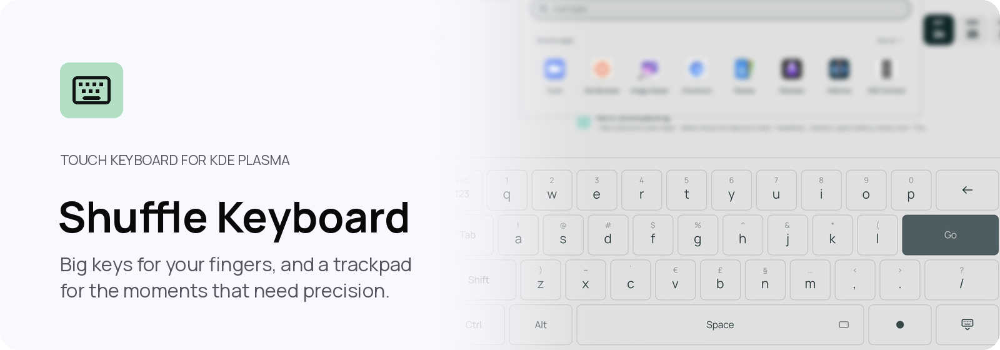

<p align="center">
  <picture>
    <source media="(prefers-color-scheme: dark)" srcset="assets/readme/banner-dark.png">
    
  </picture>
</p>

Shuffle Keyboard is a touch keyboard and precision pointer for KDE Plasma 6 on
Wayland: four large rows centred on a card at the bottom of the screen, flick
keys for the digits and punctuation, a caret trackpad on the space bar, and a
latch that turns the whole keyboard into a pointer trackpad. It runs on any
Plasma 6 desktop. The Shuffle desktop bundles it and adds a dock that steps
aside for it.

## Controls

| Task | Touch | Keyboard |
| --- | --- | --- |
| Shuffle Keyboard | Tap a text field | — |
| Precision surface | Tap the trackpad mark at the space bar's right end | — |

The Keyboard entry in the system tray (or, on Shuffle, in Control Center)
brings the keys up at any time. Tap Hide, at the bottom right, to put them away.
Every input is in [`docs/INPUT.md`](docs/INPUT.md).

- What it is: [`docs/KEYBOARD-CONTRACT.md`](docs/KEYBOARD-CONTRACT.md)
- Why it is built this way: [`docs/FEASIBILITY.md`](docs/FEASIBILITY.md)
- The by-hand pass on a touch device:
  [`docs/PHYSICAL_ACCEPTANCE.md`](docs/PHYSICAL_ACCEPTANCE.md)

## Built on KDE's Plasma Keyboard

It is a fork of KDE's Plasma Keyboard 6.7.5. It keeps Plasma Keyboard's input
delivery, Qt Virtual Keyboard and KWin's input-method path, and adds no input
engine of its own. It carries KDE's licence. The project's own names and marks
are covered separately, in [`TRADEMARKS.md`](TRADEMARKS.md).

## Build

On an Arch-family Plasma 6 development system, with Qt 6.10, KDE Frameworks
6.26 and Plasma 6.7 or later, Qt Virtual Keyboard, Qt Wayland and LayerShellQt
(`.github/workflows/arch.yml` lists the Arch packages):

```sh
cmake -S . -B build -G Ninja -DBUILD_TESTING=OFF -DCMAKE_BUILD_TYPE=RelWithDebInfo
cmake --build build
```

The executable is `build/bin/shuffle-keyboard`. `./verify.sh` formats, checks
licence headers, builds and runs the tests.

## Install

Do not replace the active desktop keyboard while developing. Install into a
staging prefix first:

```sh
cmake --install build --prefix "$PWD/stage"
```

On the device, `./install-keyboard.sh` builds the Keyboard and replaces the copy
in your own prefix. Where the sign-in screen has its own copy under
`/usr/local`, it updates that too. The new Keyboard takes over at the next
sign-in. To enable it, follow
[`docs/PHYSICAL_ACCEPTANCE.md`](docs/PHYSICAL_ACCEPTANCE.md) § Install and
enable. KWin must start the binary as its virtual keyboard. Started as a normal
application it exits, unless `SHUFFLE_PREVIEW_MODE=1` is set for an isolated
test. `./uninstall-keyboard.sh` removes exactly what `./install-keyboard.sh`
put in your prefix.

The fork installs under its own names, so it can sit beside Plasma's own
keyboard and neither loads the other's pieces: the QML modules
`org.shuffle.keyboard` and `QtQuick.VirtualKeyboard.Styles.Shuffle`, the
settings page `kcm_shufflekeyboard`, layouts under `share/shuffle-keyboard` and
settings in `shufflekeyboardrc`, which it fills from `plasmakeyboardrc` the
first time it runs. The one name it shares is the `plasma-keyboard` program the
sign-in screen starts, which Shuffle's packaging and its sign-in installer
point at this build.
